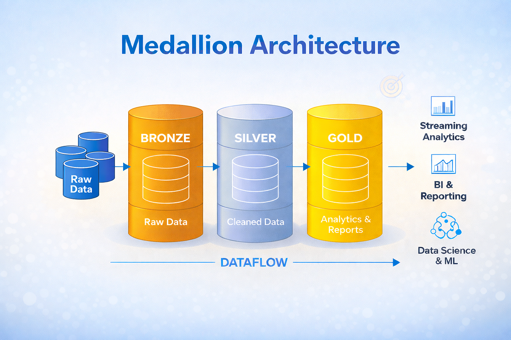

# Pizza Sales Data Warehouse & Analytics

A data engineering and analytics project focused on building a data warehouse using Google BigQuery and developing an interactive sales dashboard using Power BI.

The project implements the **Medallion Architecture (Bronze, Silver, and Gold)** to organize and transform pizza sales data into an analytical data warehouse using a Snowflake Schema.

## Project Overview

This project aims to transform raw pizza sales data into structured and analytical data to support business insights.

The data is processed through three layers using SQL in Google BigQuery, then connected to Power BI Desktop for visualization and business analysis.

### Objectives

- Build a structured data warehouse using Google BigQuery.
- Implement the Medallion Architecture.
- Perform data cleaning and transformation using SQL.
- Design a Gold layer using a Snowflake Schema.
- Analyze sales performance, product performance, customer behavior, and customer complaints.
- Develop an interactive dashboard using Power BI.

## Technology Stack

| Technology | Purpose |
|---|---|
| Google BigQuery | Cloud Data Warehouse |
| SQL | Data transformation and analysis |
| Power BI Desktop | Data visualization and dashboard development |
| Git & GitHub | Version control and project documentation |

## Data Source

**Dataset:** Pizza Sales Dataset  
**Source:** Maven Analytics

[View Original Dataset](https://mavenanalytics.io/challenges/maven-pizza-challenge)

The dataset contains pizza sales transactions, product information, pizza categories, and customer data.

For more information, see [Dataset Source](Dataset/source.md).

## Data Architecture

This project follows the Medallion Architecture, consisting of three layers:



### 1. Bronze Layer

Stores the original source data in BigQuery without major transformations.

The Bronze layer consists of five source tables:

- `mst_customer`
- `mst_pizza`
- `mst_pizza_type`
- `trx_order`
- `trx_order_detail`

### 2. Silver Layer

Contains cleaned, standardized, and transformed data.

The Silver layer consists of five tables:

- `ref_customer`
- `ref_pizza`
- `ref_pizza_type`
- `fact_order`
- `fact_order_detail`

### 3. Gold Layer

Contains analytical-ready dimensional and fact tables designed using a Snowflake Schema.

The Gold layer consists of six tables:

- `dim_category`
- `dim_customer`
- `dim_date`
- `dim_pizza`
- `dim_pizza_type`
- `fact_sales`

### Snowflake Schema


The `fact_sales` table serves as the central fact table and connects to customer, date, and pizza dimensions. The pizza dimension is further normalized into pizza type and category dimensions.

## SQL Transformation & Analysis

All data transformations are performed using SQL in Google BigQuery.

The SQL scripts are organized into the following directories:

```text
SQL/
├── Analysis/
│   └── Analytic.sql
│
├── Gold/
│   ├── ddl.sql
│   ├── dim_category.sql
│   ├── dim_customer.sql
│   ├── dim_date.sql
│   ├── dim_pizza_type.sql
│   ├── dim_pizza.sql
│   └── fact_sales_data.sql
│
└── Silver/
    ├── ddl.sql
    ├── fact_order_detail.sql
    ├── fact_order.sql
    ├── ref_customer.sql
    ├── ref_pizza_type.sql
    └── ref_pizza.sql
```

### Business Analysis

The project includes several analytical queries:

1. Monthly Sales Performance
2. Top 10 Best-Selling Pizzas
3. Revenue and Gross Profit by Category
4. Customer Purchase Analysis
5. Most Common Customer Complaints
6. Sales Performance by Day and Hour

## Dashboard

The interactive dashboard was developed using Power BI Desktop.


### Dashboard Highlights

- **Key Performance Indicators:** Total Revenue, Total Orders, Total Quantity, and Total Profit.
- **Monthly Revenue Trend:** Monitors monthly sales performance.
- **Sales Distribution by Category:** Compares revenue across pizza categories.
- **Top 10 Best-Selling Pizzas:** Identifies the most popular pizza products.
- **Top 10 Customers:** Highlights customers based on purchase activity.
- **Customer Complaint Analysis:** Analyzes the distribution of customer complaints.
- **Sales Performance by Day & Hour:** Examines sales patterns based on transaction day and hour.

## Project Structure

```text
Pizza-Sales-Data-Warehouse/
│
├── Dashboard/
│   ├── Pizza_Maven_Dashboard.pbix
│   └── Review_Dashboard.png
│
├── Dataset/
│   └── source.md
│
├── Docs/
│   ├── Architecture_Medallion.png
│   └── Snowflake_Schema.png
│
├── SQL/
│   ├── Analysis/
│   ├── Gold/
│   └── Silver/
│
└── README.md
```

## Key Takeaways

Through this project, I gained practical experience in:

- Designing a data warehouse architecture.
- Implementing Medallion Architecture.
- Writing SQL transformations in Google BigQuery.
- Building fact and dimension tables.
- Designing a Snowflake Schema.
- Performing business-oriented data analysis.
- Developing interactive dashboards using Power BI.

## Disclaimer

This project is developed for educational and portfolio purposes. The original dataset belongs to Maven Analytics.

Data transformations are executed manually using SQL in Google BigQuery. This project does not currently implement automated orchestration.

---

**Author:** Muhammad Ferran Hilmadiansyah  